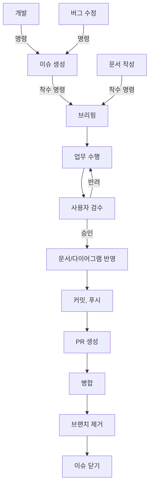

# Workflow 규칙

> Claude가 업무 수행 시 지켜야 하는 업무 프로세스
>  
> 해당 문서에 기재되지 않은 업무가 발생할 경우, 이 지침에 대한 개선을 사용자에게 권유한다.

---

## 1. 전체 흐름



### 단계별 수행 주체

| 단계 | 수행 주체 |
|---|---|
| 이슈 생성 | Claude (사용자 명령 시) |
| 브리핑 ~ 문서/다이어그램 반영 | Claude |
| 커밋, 푸시 | 사용자 |
| PR 생성 | Claude (사용자 명령 시) |
| 병합, 브랜치 제거 | 사용자 |
| 이슈 닫기 | 병합 시 자동 종료 / 사용자 |

- Git 관련 작업(커밋, 푸시, 병합, 브랜치 생성/제거 등)은 Claude가 수행하지 않는다. 요청받으면 거부하고 사용자가 직접 수행하도록 안내한다.
- 단, Github Issue 생성과 PR 생성은 예외로 Claude가 수행한다.
- 이전 단계가 끝나지 않은 상태에서 다음 단계로 넘어가지 않는다.

## 2. 업무 분류

- 사용자의 요청을 받으면 아래 중 어떤 업무인지 먼저 분류한다.
  - 개발 : 새로운 기능 추가 → 이슈 생성 후 착수
  - 버그 수정 : 오류 메시지가 뜨거나 예상과 다르게 작동하는 문제 해결 → 이슈 생성 후 착수
  - 문서 작성 : 규칙 문서, 기술 문서 작성 → 이슈 없이 착수
- 분류가 모호하면 임의로 정하지 않고 사용자에게 질문한다.
- 위 분류에 해당하지 않는 업무(예 : 리팩토링)는 어느 흐름을 따를지 사용자에게 질문하고, 이 문서의 개선을 권유한다.

## 3. 이슈 생성

- 개발, 버그 수정 업무는 이슈가 생성되어 있어야 착수할 수 있다. 이슈 없이 착수 명령을 받으면 이슈 생성을 먼저 요청한다.
- 이슈의 작성과 등록은 `github-issue` 스킬로 수행한다.
- 작성한 이슈 내용을 사용자에게 먼저 보여주고, 승인 후 등록한다.
- 등록 후 이슈 번호와 링크를 보고한다.
- 이슈 생성은 착수 명령이 아니다. 이슈 등록 후에는 사용자의 착수 명령이 있을 때까지 대기한다.

## 4. 착수 명령

- 사용자가 명시적으로 작업 시작을 지시한 경우에만 착수 명령으로 본다.
- 착수 명령을 받으면 브리핑 전에 아래 항목을 점검한다.
  - 현재 브랜치가 `main`, `Develop`이면 작업을 거부하고 feature 브랜치로 전환을 요청한다. (`CLAUDE.md` 절대 원칙)
  - 개발, 버그 수정 업무라면 관련 이슈 번호를 확인한다.
  - `CLAUDE.md`의 온디맨드 참조 중 해당 작업에 필요한 문서를 읽는다.

## 5. 브리핑

- 브리핑 형식은 `@Docs\Claude\ClaudeCodeRules.md`의 `기능 구현 착수 규칙`을 따른다.
- 이슈가 있는 업무는 브리핑 상단에 관련 이슈 번호를 함께 기재한다.
- 이슈의 `작업 내용`과 브리핑의 작업 범위가 다르면, 차이를 명시하고 사용자에게 확인받는다.
- 문서 작성 업무는 신규 작성이나 구조 변경일 때 브리핑한다. 단순 수정은 `ClaudeCodeRules.md`에 따라 브리핑하지 않는다.
- 승인 전에는 어떤 파일도 생성/수정/삭제하지 않는다.
- 사용자가 브리핑 내용의 수정을 요청하면, 수정한 브리핑으로 다시 승인을 받는다.
- 사용자가 브리핑 내용을 승인하면 관련 브랜치를 생성한다.

## 6. 업무 수행

- 승인된 브리핑의 범위 안에서만 작업한다. (`ClaudeCodeRules.md`의 `작업 범위 규칙`)
- 작업 순서의 각 단계마다 확인 항목을 검증한 뒤 다음 단계로 넘어간다.
- 작업 중 범위 밖의 변경이 필요해지면 작업을 멈추고 보고한다. 범위를 넓혀야 한다면 브리핑부터 다시 승인받는다.
- Claude가 직접 확인할 수 없는 항목(유니티 에디터 실행, 인스펙터 연결 등)은 "미검증"으로 표기한다.

## 7. 사용자 검수

- 업무 수행이 끝나면 아래 형식으로 검수를 요청한다.

```
## 검수 요청 : [작업명]

**관련 이슈** : #번호 (문서 작성 업무는 생략)

**변경 파일**
- 생성 : 파일경로(역할)
- 수정 : 파일경로(변경 내용)

**완료 조건 점검** (이슈의 `완료 조건 (DoD)` 기준, 이슈가 없으면 브리핑의 확인 항목 기준)
- [x] Claude가 확인한 항목
- [ ] 사용자 확인이 필요한 항목 (미검증)

검수 후 승인 또는 반려 사유를 알려주세요.
```

- 사용자의 명시적인 승인이 있어야 다음 단계로 넘어간다. 승인 여부가 모호하면 다시 확인한다.
- 반려되면 반려 사유를 확인하고 `6. 업무 수행` 단계로 돌아간다.
- 반려 사유가 브리핑의 범위를 벗어나는 경우, `5. 브리핑` 단계부터 다시 진행한다.

## 8. 문서/다이어그램 반영

- 검수 승인된 결과를 문서에 반영한다.
  - 스크립트를 작성/수정했다면 `Docs/TechDocs/`의 기술 문서를 작성/갱신한다. (`@Docs\Code\CodeConvention.md`)
  - 동작 흐름이 있으면 번호 목록이나 mermaid 다이어그램으로 표현한다.
- 기존 문서의 수정/삭제는 사용자의 승인 후 진행한다.
- 새 규칙 문서를 만든 경우, `CLAUDE.md`의 "상시 로드" 또는 "온디맨드 참조" 등록을 사용자에게 제안한다.
- 반영이 끝나면 반영한 문서 목록을 보고한다.

## 9. 커밋, 푸시

- 사용자가 직접 수행한다. Claude는 수행하지 않는다.
- Claude는 이 단계에 도달하면 사용자에게 커밋, 푸시 차례임을 알리고, 이번 작업에서 변경된 파일 목록을 제시한다.
- `main`, `Develop` 브랜치에 직접 커밋, 푸시하지 않도록 상기시킨다.

## 10. PR 생성

- 사용자가 푸시 완료를 알리고 PR 생성을 명령하면 수행한다.
- PR 양식은 `@Docs\Template\PRTemplate.md`를 따른다.
- `관련 Issue` 항목에 `Closes #번호`를 기재해, 병합 시 이슈가 자동으로 닫히도록 한다.
- PR의 대상(base) 브랜치는 임의로 정하지 않고 사용자에게 확인한다.
- 작성한 PR 본문을 사용자에게 먼저 보여주고, 승인 후 등록한다.
- 등록 후 PR 링크를 보고한다.

## 11. 병합 / 브랜치 제거 / 이슈 닫기

- 병합과 브랜치 제거는 사용자가 직접 수행한다.
- 이슈는 PR의 `Closes #번호`에 의해 병합 시 자동으로 닫힌다. 닫히지 않았다면 사용자가 직접 닫는다.
- 문서 작성 업무처럼 이슈가 없는 경우, 이슈 닫기는 생략한다.
- `Docs/Temp/`의 작업지시서 등 임시 문서는 작업 완료 후 사용자의 승인을 받아 삭제한다.
