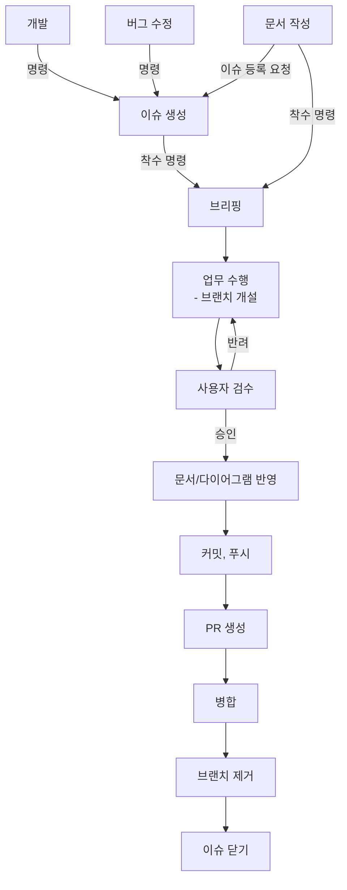

# Workflow 규칙

> Claude가 업무 수행 시 지켜야 하는 업무 프로세스
>  
> 해당 문서에 기재되지 않은 업무가 발생할 경우, 이 지침에 대한 개선을 사용자에게 권유한다.

---

## 0. 전체 흐름

- 모든 업무는 아래 흐름을 따르며, 단계를 건너뛰거나 순서를 바꾸지 않는다.
- 각 단계는 이전 단계의 완료(또는 사용자 승인)가 확인된 뒤에만 진행한다.
- Git 작업은 가능할 때만 수행하며, 불가능할 경우 해당 작업의 절차를 사용자에게 알리고 사용자가 이를 직접 수행한다.



## 1. 업무 분류

- 요청을 받으면 가장 먼저 아래 표를 기준으로 업무를 분류한다.
- 분류가 모호하면 임의로 정하지 않고 사용자에게 질문한다.

| 분류 | 정의 | 이슈 | Label | 브랜치 접두어 | 커밋 태그 |
|---|---|---|---|---|---|
| 개발 | 새로운 기능 추가 | 필요 | Feature | `feat` | `[Feat]` |
| 〃 | 기능 변경이 없는 코드 구조 개선(리팩토링) | 필요 | Refactor | `refactor` | `[Refactor]` |
| 버그 수정 | 오류가 발생하거나 예상과 다르게 동작하는 기능 수정 | 필요 | Bug | `fix` | `[Fix]` |
| 문서 작성 | `Docs/` 하위 규칙/기술 문서의 작성 및 수정 | 요청 시 | Docs | `docs` | `[Docs]` |

- 문서 작성 업무는 사용자가 이슈 작성을 요청한 경우에만 이슈를 등록한다.
- 오타 수정 등 단순 수정은 `@Docs\Claude\ClaudeCodeRules.md`의 `기능 구현 착수 규칙`에 따라 브리핑 형식을 생략한다.

## 2. 이슈 생성

- `github-issue` 스킬을 호출해 진행한다. 이슈 작성 규칙은 이 문서에 옮겨 적지 않는다.
- 이슈 등록이 완료되면 즉시 업무에 착수하지 않고, 사용자의 착수 명령을 대기한다.

## 3. 착수 명령

- 사용자의 명시적인 착수 명령이 있어야 브리핑으로 넘어간다.
- 개발 / 버그 수정 업무인데 연결된 이슈가 없는 상태로 착수 명령을 받으면, `2. 이슈 생성`으로 돌아가 이슈 등록을 먼저 권유한다.

## 4. 브리핑

- 브리핑 형식은 `@Docs\Claude\ClaudeCodeRules.md`의 `기능 구현 착수 규칙`을 따른다.
- 위 형식에 더해, 아래 항목을 브리핑에 포함한다.
  - **연결 이슈** : `#번호` (관련 이슈 존재 시)
  - **작업 브랜치** : `5. 업무 수행`의 브랜치 이름 규칙에 따른 브랜치명
- 브리핑 전, 생성/수정 대상 파일과 폴더의 실제 존재 여부를 확인한다.
- 사용자의 승인 전에는 파일을 생성/수정하지 않는다.
- 브리핑 내용이 사용자의 피드백으로 바뀌면, 수정된 브리핑을 다시 제시하고 승인을 받는다.

## 5. 업무 수행 (브랜치 개설)

### 브랜치 개설

- 업무 수행의 첫 단계로, 최신 `main`을 기준으로 작업 브랜치를 개설한다.
- 이미 해당 업무의 작업 브랜치에 있다면 새로 개설하지 않는다.
- 브랜치 이름은 `{접두어}/{GitHub ID}/{작업명}` 형식으로 한다.
  - 접두어는 `1. 업무 분류`의 표를 따른다.
  - 작업명은 영문으로 간결하게 작성한다.
- 예시 :
  ```
  feat/pistol357/playerMove
  fix/pistol357/jumpDoubleInput
  docs/pistol357/ai-agent
  ```

### 작업 진행

- 브리핑에서 승인받은 범위와 작업 순서대로만 진행한다.
- 작업 범위 밖의 문제를 발견하면 수정하지 않고 보고만 한다.
- 소스코드 작성 시 `@Docs\Code\CodeConvention.md`와 `@Docs\TechSpec.md`를 따른다.
- 진행 중 브리핑과 다른 판단이 필요해지면 작업을 멈추고 사용자에게 질문한다.

## 6. 사용자 검수

- 작업이 끝나면 아래 형식으로 검수를 요청한다.
  ```
  ## 검수 요청 : [작업명]

  **변경 파일**
  - 생성 : 파일경로(역할)
  - 수정 : 파일경로(변경 내용)

  **확인 항목** (이슈의 완료 조건(DoD) 기준, 이슈가 존재하지 않는 작업은 브리핑의 확인 항목 기준)
  - [ ] 확인 항목 1
  - [ ] 확인 항목 2

  **미검증 사항**
  - Claude가 직접 확인하지 못한 항목 (예 : 유니티 에디터에서의 동작, 컴파일 에러 여부)

  검수 후 승인 또는 반려 사유를 알려주세요.
  ```
- 유니티 에디터에서의 동작 확인이 필요한 항목은 사용자에게 확인 방법을 함께 안내한다.

### 반려

- 반려 사유를 정리해 사용자에게 확인받은 뒤, `5. 업무 수행`으로 돌아가 수정한다.
- 반려 사유로 작업 범위가 바뀌면 `4. 브리핑`부터 다시 진행한다.
- 수정이 끝나면 다시 검수를 요청한다.

### 승인

- 사용자의 명시적인 승인이 있어야 다음 단계로 넘어간다.

## 7. 문서/다이어그램 반영

- 이번 변경으로 내용이 달라져야 하는 `Docs/` 하위 문서와 다이어그램을 찾아 목록으로 보고한다.
  - 예 : 기술 스택 변경 → `Docs\TechSpec.md`, 클래스 구조 변경 → 해당 다이어그램
- 반영 대상 문서의 수정은 `CLAUDE.md`의 절대 원칙에 따라 사용자 승인 후 진행한다.
- 반영할 대상이 없으면 "반영 대상 없음"을 보고하고 다음 단계로 넘어간다.

## 8. 커밋, 푸시

### 커밋

- `main`, `Develop` 브랜치에서는 커밋하지 않는다. (`CLAUDE.md` 절대 원칙 1)
- 커밋 전 `git status`와 `git diff`로 변경 사항을 확인하고, 작업 범위의 파일만 스테이징한다.
  - `git add .`, `git add -A`처럼 전체를 스테이징하지 않는다.
  - 작업 범위 밖의 변경 파일이 있으면 커밋에 포함하지 않고 사용자에게 보고한다.
- 커밋 메시지는 `[커밋 태그] 작업 요약` 형식으로 작성한다.
  - 커밋 태그는 `1. 업무 분류`의 표를 따른다.
- 예시 :
  ```
  [Feat] 플레이어 점프 기능 구현
  [Fix] 점프 중복 입력 버그 수정
  [Docs] 워크플로우 규칙 문서 작성
  ```

### 푸시

- 작업 브랜치를 원격 저장소에 푸시한다. (`git push -u origin {브랜치명}`)
- `--force` 등 원격 이력을 덮어쓰는 푸시는 하지 않는다.
- 푸시 실패 시 임의로 해결하지 않고, 원인과 함께 사용자에게 보고한다.

## 9. PR 생성

- PR 본문은 `@Docs\Template\PRTemplate.md`의 형식으로 작성한다.
- PR 제목은 커밋 메시지와 같은 `[커밋 태그] 작업 요약` 형식으로 작성한다.
- base 브랜치는 `main`으로 한다. (`Develop` 브랜치 도입 시 이 항목을 갱신한다.)
- 이슈가 작성된 업무는 `관련 Issue`에 `Closes #번호`를 기재해, 병합 시 이슈가 닫히도록 한다.
- 등록 전 초안을 사용자에게 제시하고, 승인 후 `gh pr create`로 등록한다.
- 등록 후 PR 번호와 링크를 보고한다.

## 10. 병합

- 사용자의 명시적인 병합 명령이 있어야 병합한다.
- 병합 전 충돌 여부를 확인하고, 충돌이 있으면 임의로 해결하지 않고 사용자에게 보고한다.
- 병합 방식은 Merge commit으로 한다. (`gh pr merge --merge`)

## 11. 브랜치 제거

- 병합이 완료된 것을 확인한 뒤 진행한다.
- `main`으로 전환하고 최신 상태로 갱신(`git pull`)한 뒤, 작업 브랜치를 제거한다.
  - 로컬 브랜치 : `git branch -d {브랜치명}`
  - 원격 브랜치 : `git push origin --delete {브랜치명}`
- 병합되지 않은 브랜치를 강제 삭제(`git branch -D`)하지 않는다.

## 12. 이슈 닫기

- 작성된 이슈가 있다면, `gh issue view {번호}`로 `Closes #번호`에 의해 이슈가 닫혔는지 확인한다.
- 닫히지 않았다면, 처리된 PR 번호를 코멘트로 남기고 이슈를 닫는다. (`gh issue close {번호} --comment`)
- 이슈 닫기까지 완료되면 아래 형식으로 업무 종료를 보고한다.
  ```markdown
  ## 업무 완료 : [작업명]

  - **이슈** : #[번호] (Closed) (관련 이슈 존재 시)
  - **PR** : #[번호] (Merged)
  - **제거된 브랜치** : [브랜치명]
  ```
