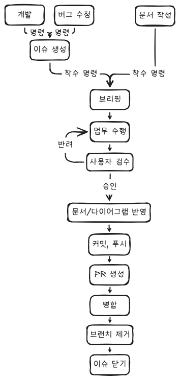

# 작업지시서

> 해당 작업이 완료될 경우, 이 파일을 삭제한다.
>  
> 사용자의 명시적인 언급이 없는 경우, 임의로 파일에 대한 수정/삭제를 하지 않는다.
>  
> 기존 파일의 수정/삭제가 권장되는 경우, 반드시 사용자의 승인 후 진행한다.

---

## 작업 내용

- Claude Code를 활용해 개발 업무를 수행할 때를 대비한 워크플로우 규칙 문서 작성
- `image.png`를 참고해 워크플로우에 대한 규칙 문서를 작성한다.
- 문서에는 각 섹션 (예 : 브리핑, 업무 수행(업무 착수), 사용자 검수 등)에 대한 규칙을 상세하게 기재한다.
- 하단 참고자료로 제시된 문서들을 기반으로, 문서 스타일을 통일해 작성한다.
- 이 업무를 위한 Github Issue는 생성하지 않는다.

## 작업 대상

- 워크플로우 규칙 문서 : `Docs\Claude\WorkflowRules.md`

## 참고 자료

- `Docs/` 경로 하위의 모든 규칙 문서